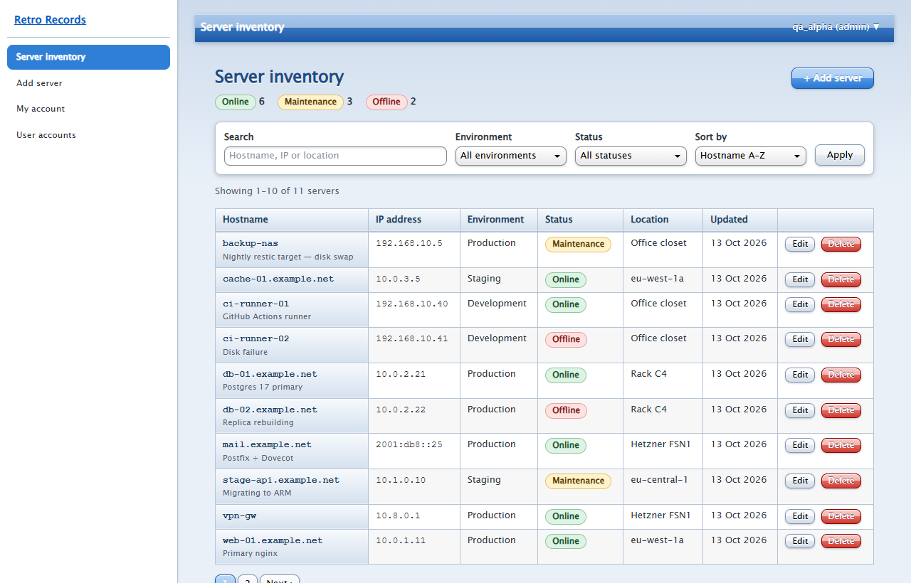
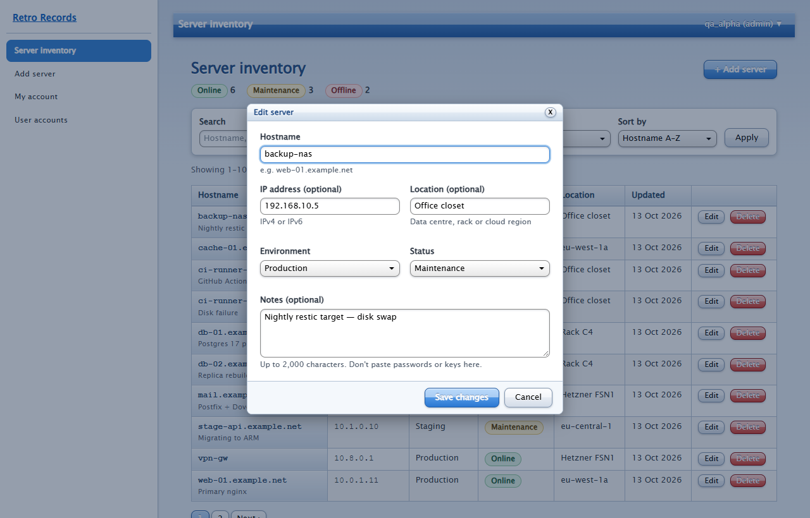
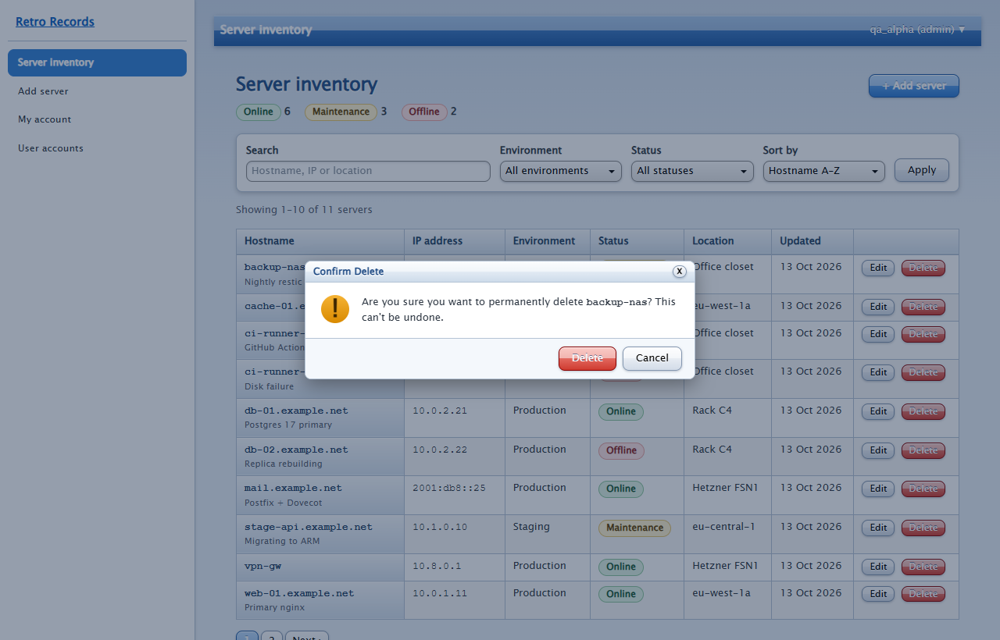
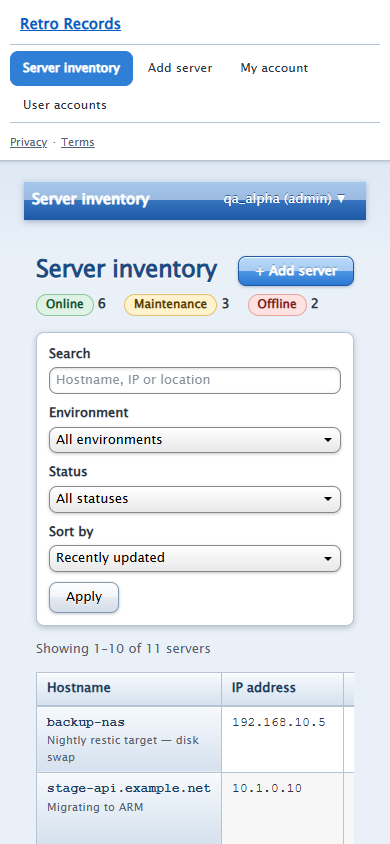

# Retro Records

A secure server-inventory app with a 2006-style web dashboard look. Sign up, then add, search, edit and delete
records for the machines you look after. It's built with plain PHP 8, PostgreSQL and vanilla JavaScript: no framework,
no build step.

**Live demo:** https://retro-records.vercel.app



## Features

- **Accounts:** sign up and sign in with a username or email. Passwords are hashed with Argon2id, falling back to bcrypt
  where Argon2 isn't available.
- **Server inventory (CRUD):**
  - Add servers with a hostname, IP, location, environment, status and notes.
  - Browse them in a paginated, searchable, filterable table.
  - Edit in a pre-filled modal dialog, and delete through a desktop-style confirmation window.
  - Plain pages back up both dialogs, so everything works with JavaScript turned off.
- **Admin view:** administrators can see accounts and unlock locked ones. They can't see anyone's records.
- **Account settings:** change your password or delete your account. Deleting it removes all your data.

| Edit dialog | Delete confirmation | Mobile |
| --- | --- | --- |
|  |  |  |

## Security

| Threat | What the app does |
| --- | --- |
| SQL injection | Every query is a PDO prepared statement with bound parameters, and emulated prepares are off. Sort columns come from a fixed allowlist. |
| XSS | All output goes through `htmlspecialchars(…, ENT_QUOTES, 'UTF-8')`. A strict CSP (`script-src 'self'`, no inline script or style) means injected markup can't run. |
| CSRF | A per-session 256-bit token is checked with `hash_equals` on every POST, PUT and DELETE, alongside an Origin check. Cookies are `SameSite=Strict`. |
| Session hijacking | The session cookie is `__Host-`-prefixed, `HttpOnly`, `Secure` and `SameSite=Strict`. The ID is regenerated on sign-in, and strict mode is on. Sessions end after **15 minutes idle** or 12 hours total. |
| Password theft | Argon2id hashes are upgraded automatically if the algorithm changes. Unknown usernames take the same time to fail as known ones. |
| IDOR | Every query is scoped to `owner_id`. **PostgreSQL row-level security** also enforces ownership in the database itself, so a missed `WHERE` still returns nothing. Someone else's record returns 404, which hides that it exists. |
| Brute force | An account locks for 15 minutes after **5 failed sign-ins**. Per-IP rate limits apply to sign-in (20 per 15 min), sign-up (5 per hour), password checks and all writes. IPs are stored only as HMAC hashes. |
| Clickjacking and sniffing | `frame-ancestors 'none'`, `X-Frame-Options: DENY`, `nosniff`, HSTS, `Referrer-Policy` and `Permissions-Policy` are all set. |
| Information leaks | Users see generic error pages. Details are logged server-side only. |

The database role the app connects with has only `SELECT/INSERT/UPDATE/DELETE` on its own schema. It isn't the
database owner, so row-level security applies to it.

`tests/security.php` runs 26 checks against a running server, covering CSRF, IDOR, RLS, lockout, rate limiting,
session expiry, cookie flags, headers and SQL injection.

## Tech stack

- **Backend:** PHP 8.2+ (object-oriented), with a small custom router and middleware pipeline and a database-backed session handler
- **Database:** PostgreSQL 15+ (hosted on Supabase), with foreign keys, row-level security and indexes for each query pattern
- **Frontend:** semantic HTML5, vanilla ES2020 JavaScript, and the [Oldweb UI](https://github.com/ChAbdulWahhab/OldwebUI) `web20` theme (MIT, vendored in `public/css`)
- **Hosting:** Vercel, using the community [`vercel-php`](https://github.com/vercel-community/php) runtime in the Mumbai region, next to the database

```
api/index.php        front controller (the only Vercel function)
src/                 App, Router, Middleware, Controllers, Repositories, Security, Validation
templates/           PHP views; all output escaped with e()
public/              static CSS, JS, favicon, robots.txt, sitemap.xml
database/            schema.sql (tables, indexes, RLS) and roles.sql (least-privilege app role)
tests/security.php   end-to-end security checks
```

## Local setup

Requirements: PHP 8.2+ with the `pdo_pgsql`, `mbstring` and `openssl` extensions, and a PostgreSQL 15+ database.

1. Clone the repo and copy the env file:
   ```bash
   git clone https://github.com/fazal305/retro-records.git
   cd retro-records
   cp .env.example .env
   ```
2. Create the schema. Run `database/schema.sql`, then `database/roles.sql` as a superuser, after changing `CHANGE_ME`
   to a strong password.
3. Fill in `.env`:

   | Variable | Purpose |
   | --- | --- |
   | `APP_ENV` | `local` or `production` |
   | `APP_URL` | Public base URL, used for canonical and Open Graph tags |
   | `APP_KEY` | 64 random hex characters, used to HMAC client IPs for rate limiting |
   | `TRUST_PROXY` | `vercel` when deployed on Vercel, otherwise blank |
   | `DB_HOST`, `DB_PORT`, `DB_NAME` | Database connection |
   | `DB_USER`, `DB_PASSWORD` | The `retro_app` role. With the Supabase pooler the user is `retro_app.<project-ref>`. |
   | `DB_SSLMODE` | `require` for hosted databases |

4. Run it:
   ```bash
   php -S localhost:8091 -t public dev-server.php
   ```
5. Make yourself an admin after signing up:
   ```bash
   php bin/promote-admin.php your-username
   ```
6. Run the security checks:
   ```bash
   php tests/security.php http://localhost:8091
   ```

Note that the session cookie is `Secure`. Browsers accept it on `http://localhost`, but not on other plain-HTTP hosts.

## Deploying to Vercel

Import the repo, add the environment variables above (with `TRUST_PROXY=vercel`) and deploy. `vercel.json` routes
every non-static request to `api/index.php`, serves only `public/` as static files, and pins the function to `bom1`.

## License

[MIT](LICENSE). The bundled Oldweb UI stylesheet is also MIT; see `public/css/oldweb-LICENSE.txt`.
